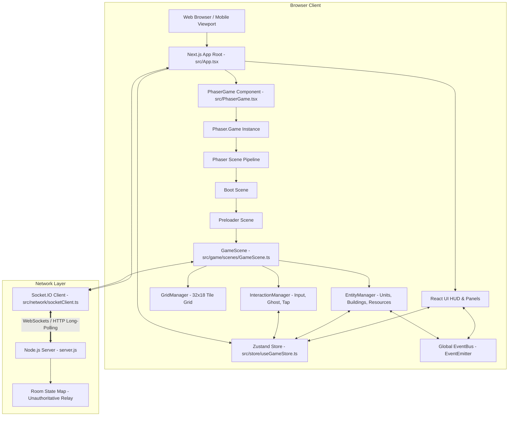
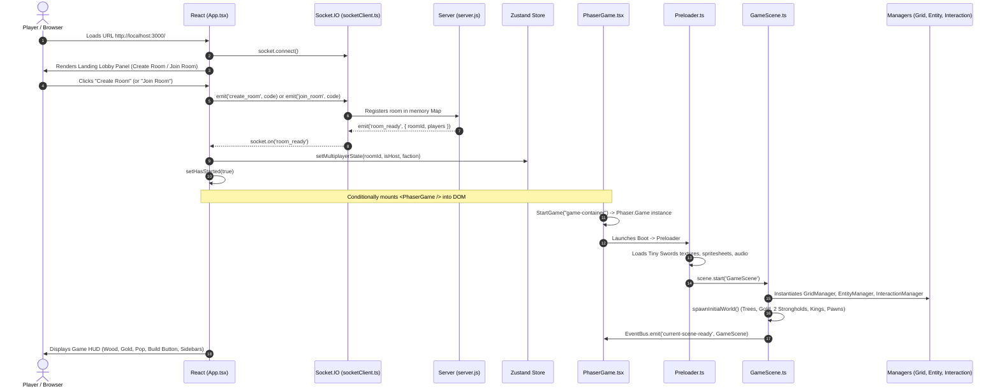
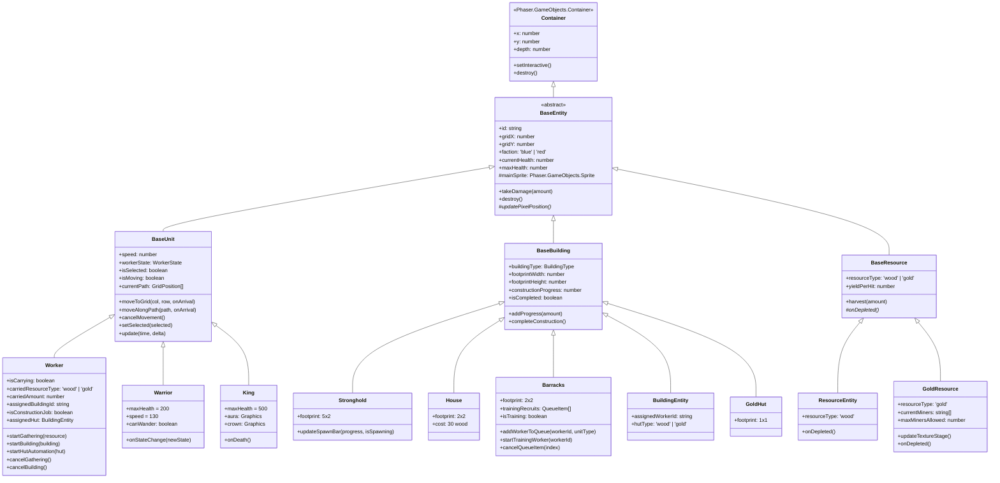
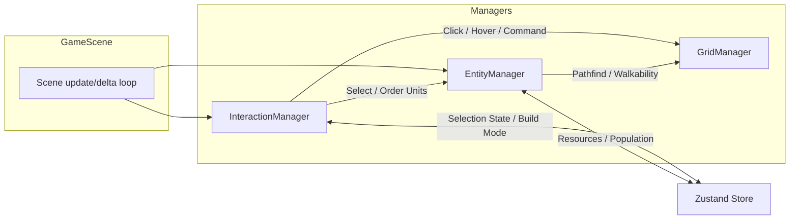

# Pocket Crusader — Architecture Reconstruction

## 1. Overview & System Topology

Pocket Crusader is built as a hybrid **Next.js (React 19) + Phaser 3 + Socket.IO** web application. The frontend orchestrates application state, room lobby UI, and tactical HUD controls using React and Zustand, while Phaser 3 operates as the canvas-based 2D simulation engine handling rendering, tilegrid manipulation, entity animations, pathfinding, and input dispatching.

---

## 2. Initialization & Lifecycle Flow

Tracing the step-by-step lifecycle from page request to gameplay loop:

### Detailed Flow Steps

1. **Browser Loading & DOM Mount:**
   - Next.js renders `src/pages/_app.tsx` and `src/pages/index.tsx`, which mounts `src/App.tsx`.
   - `App.tsx` establishes a client Socket.IO connection via `src/network/socketClient.ts` if not already connected.
   - Initial UI renders `.container` with glassmorphic lobby buttons: "Create Room" and "Join Room".

2. **Lobby & Matchmaking Handshake:**
   - Host clicks "Create Room", which generates a 4-character uppercase alphanumeric code (e.g., `NI5P`) and emits `create_room` to `server.js`.
   - Guest types room code and clicks "Join Room", emitting `join_room`.
   - Once 2 clients join the same room ID, `server.js` emits `room_ready` to the room channel.
   - Upon receiving `room_ready`, `App.tsx` updates Zustand (`setMultiplayerState`), triggers `requestFullscreenAndLock()`, and flips `hasStarted = true`.

3. **Phaser Game Instantiation:**
   - `hasStarted === true` triggers mounting of `<PhaserGame ref={phaserRef} />`.
   - `PhaserGame.tsx` executes `useLayoutEffect`, calling `StartGame("game-container")` from `src/game/main.ts`.
   - `StartGame` instantiates `Phaser.Game` with configuration:
     - Dimensions: 1024 x 768 (ScaleMode: `Phaser.Scale.FIT`, AutoCenter: `CENTER_BOTH`).
     - Physics: None (Grid-based movement via Tweens and EasyStar.js).
     - Scenes: `[Boot, Preloader, GameScene]`.
   - `PhaserGame.tsx` injects the shared socket instance into Phaser registry: `game.current.registry.set('socket', socket)`.

4. **Scene Initialization & Asset Preloading:**
   - `Boot.ts` runs synchronously, setting up any device-level pre-checks, then invokes `scene.start('Preloader')`.
   - `Preloader.ts` displays a loading progress bar (`this.load.on('progress')`), sets asset root path `assets/tiny-swords`, and preloads:
     - Terrain: `Tilemap_color1.png`, `Tree1.png`, `Stump 1.png`.
     - Units: Pawn Idle, Run, Chop, Mine, Hammer, Wood/Gold carrying spritesheets (both Blue and Red factions).
     - Warriors: Warrior Idle, Run, Attack spritesheets (Blue and Red).
     - Buildings: House, Woodcutter's Hut, Castle/Stronghold, Gold Hut, Barracks.
     - Gold Stones: Stages 1 through 6.
     - Icons: Coin, Log, Hammer, Meat, Sword, Avatars.
   - Once all assets complete loading, `Preloader.ts` executes `this.scene.start('GameScene')`.

5. **World Spawning & Simulation Startup:**
   - `GameScene.create()`:
     1. Creates frame-by-frame sprite animations for pawns, warriors, and swaying trees (`createAnimations()`).
     2. Draws visual grass tiles (32 cols x 18 rows = 2048 x 1152 world pixels) and debug grid lines (`drawTileGrid()`, `drawGridLines()`).
     3. Initializes core managers:
        - `GridManager`: Constructs 32x18 walkability grid and sets up `EasyStar.js`.
        - `EntityManager`: Tracks active units, buildings, and resources; sets up population and auto-worker timers.
        - `InteractionManager`: Registers click/touch handlers, ghost building preview, and unit selection.
     4. Executes `spawnInitialWorld()`:
        - 15 tree obstacles (`ResourceEntity`, 3 HP, 5 wood/hit).
        - 2 gold nodes (`GoldResource`, 60 HP, 10 gold/hit).
        - Blue base (Left): Stronghold at (6, 9), King at (5, 9), 3 Pawns at (5, 10), (6, 11), (7, 10).
        - Red base (Right): Stronghold at (25, 9), King at (24, 9), 3 Pawns at (24, 10), (25, 11), (26, 10).
     5. Configures camera bounds (2048 x 1152) and touch panning/pinch-zoom handlers.
     6. Hooks socket event listeners for remote sync (`server_unit_move`, `server_spawn_unit`, etc.).
     7. Emits `EventBus.emit('current-scene-ready', this)` to announce completion to React.

---

## 3. Entity Architecture & Inheritance Hierarchy

All game world objects inherit from Phaser container primitives to support compound layering (base sprite, health bar, selection circles, carry icons, and crowns).

### Key Architectural Characteristics of Entities

1. **Compound Phaser Containers:**
   Every entity (`BaseEntity` extending `Phaser.GameObjects.Container`) groups the primary animated sprite (`mainSprite`), shadows, hitboxes, selection rings, progress bars, and floating text into a unified local coordinate frame.
2. **Depth Sorting:**
   Entities maintain isometric-style depth ordering dynamically via `this.setDepth(this.y)` in `updatePixelPosition()`. When units walk, depth updates continuously based on pixel Y.
3. **Hitbox Separation:**
   Hitbox rectangles are configured in container-local coordinates (e.g. `Rectangle(-32, -64, 64, 64)`) while the container's (x, y) anchors at the bottom-center of the tile footprint.

---

## 4. Manager Responsibilities & System Boundaries

The gameplay layer is partitioned across three core managers instantiated in `GameScene`:

### 1. GridManager (`src/game/managers/GridManager.ts`)
- **Dimensions:** Fixed 32 columns x 18 rows with 64x64 pixel tiles (`MAP_WIDTH = 2048`, `MAP_HEIGHT = 1152`).
- **Pathfinding Engine:** Integrates `easystarjs` (v0.4.4).
- **Responsibilities:**
  - Maintains a 2D integer grid array (`0` = walkable, `1` = blocked).
  - Synchronous tile queries: `isTileWalkable(col, row)`, `isAreaWalkable(col, row, width, height)`.
  - Tile manipulation: `blockTile()`, `unblockTile()`, `blockArea()`, `unblockArea()`.
  - Asynchronous path computation: `findPath(start, goal, callback)` with diagonal movement enabled (`enableDiagonals()`) and corner-cutting disabled (`disableCornerCutting()`).
  - Spatial adjacency queries: `findAdjacentWalkable()`, `findCardinalAdjacentWalkable()`, `getRandomAdjacentWalkable()`, `getClosestAdjacentWalkable()`.
  - Coordinate conversions: `gridToWorld()`, `worldToGrid()`, `getTileCenter()`.

### 2. EntityManager (`src/game/managers/EntityManager.ts`)
- **Collections:** Maintains three flat arrays: `units: BaseUnit[]`, `buildings: BaseBuilding[]`, `resources: BaseResource[]`.
- **Responsibilities:**
  - Entity Registry: Registration (`addUnit`, `addBuilding`, `addResource`) and lookups (`getUnitById`, `getBuildingById`, `findUnitById`).
  - Simulation Loop: Ticks all active units, buildings, and resources every frame (`update(time, delta)`).
  - Population Management:
    - Periodic spawn timer (every 10s): Spawns new workers at Stronghold if `currentPopulation < maxPopulation`.
    - Updates Stronghold spawn progress bar.
    - Recalculates population metrics: `workerCount`, `warriorCount`, `availableWorkersCount`.
  - Autonomous Worker Dispatch:
    - Auto-assigns idle workers to unfinished construction sites every 2 seconds (`assignIdleWorkers()`).
    - Dispatches workers to automated huts (`dispatchWorkerToHut()`).
    - Dispatches workers to Barracks for military training (`dispatchWorkerToTrain()`).
    - Autonomous worker wandering loop for idle pawns (`processWanderingAI()`).
  - Entity Factories: Spawns new warriors (`spawnWarrior`) and workers (`checkPopulationAndSpawn`).

### 3. InteractionManager (`src/game/managers/InteractionManager.ts`)
- **Input Channels:** Listens to Phaser pointer events (`pointerdown`, `pointermove`, `pointerup`).
- **Responsibilities:**
  - Selection System: Taps on units, buildings, and resources; syncs selection to Zustand store (`selectedUnitId`, `selectedBuildingId`); renders tap indicators.
  - Movement Command Dispatch: When walkable ground is tapped with a unit selected, calculates path, triggers tween movement, and emits `client_unit_move` over Socket.IO.
  - Build Mode Subsystem:
    - Polls Zustand `isPlacingBuilding` each frame.
    - Renders translucent ghost sprite (`ghostSprite`) and validity overlay (`ghostOverlay` green/red).
    - Checks footprint validity via `GridManager.isAreaWalkable()`.
    - Handles mobile drag-to-place and tap-to-place gestures.
    - On confirmation: verifies resource costs, deducts resources from Zustand, spawns `BaseBuilding` subclass, blocks grid tiles in `GridManager`, auto-dispatches nearest idle worker, and emits `client_build_structure`.

---

## 5. Template Code vs. Custom Gameplay Code

To distinguish inherited template boilerplate from custom code developed for Pocket Crusader:

| Subsystem / File | Origin | Evidence & Customization Level |
|---|---|---|
| `src/PhaserGame.tsx` | Official Phaser Next.js Template | Standard Phaser React bridge (`IRefPhaserGame`, `EventBus`, `useLayoutEffect`, `
`). Customized slightly to inject socket into registry. |
| `src/game/main.ts` | Official Phaser Template | Standard game config initialization (`type: Phaser.AUTO`, scale configuration, scene list). |
| `src/game/EventBus.ts` | Official Phaser Template | Simple `new Phaser.Events.EventEmitter()` singleton. |
| `src/game/scenes/Boot.ts` | Official Phaser Template | Unmodified 14-line scene switching to Preloader. |
| `src/game/scenes/Preloader.ts` | Template structure, fully custom assets | Standard Phaser loading bar structure, but 100% custom sprite definitions for Tiny Swords pack (Pawns, Warriors, Gold stones, Buildings, Icons). |
| `src/game/scenes/GameScene.ts` | 100% Custom RTS Implementation | Custom grid generation, manager orchestration, network relays, unit factories, and mobile gesture camera. |
| `src/game/managers/*` | 100% Custom Gameplay Engine | Custom RTS managers (`GridManager`, `EntityManager`, `InteractionManager`). |
| `src/game/entities/*` | 100% Custom Gameplay Entities | Custom entity hierarchy with compound containers, animation states, worker AI, and barracks training. |
| `src/store/*` | 100% Custom State Engine | Custom multi-slice Zustand store (`gameStateSlice`, `resourceSlice`, `uiSlice`). |
| `server.js` | Custom Node.js Relay | Custom Socket.IO room and multiplayer packet relay. |

---

## 6. Architectural Weaknesses & Structural Antipatterns

1. **Dual Event Bus Antipattern:**
   The project maintains two distinct event systems without clear separation:
   - Global `EventBus` (`src/game/EventBus.ts`) for cross-framework communication between React and Phaser.
   - Scene-level event emitter (`this.scene.events`) for internal scene notifications.
   This leads to confusing registration patterns where handlers call `EventBus.off('train_warrior')` inside constructors to avoid duplicate registrations on re-renders.

2. **Zustand Polling in Game Loop:**
   `InteractionManager.pollBuildModeFromStore()` hooks into `this.scene.events.on('update')` to check `useGameStore.getState().isPlacingBuilding` every single frame (60 FPS) instead of responding to reactive store changes or event emissions.

3. **High-Frequency React Re-renders from Game Loop:**
   In `Barracks.update()` (line 316), when a barracks is selected, `store.setTrainingState(uiQueue, this.currentTrainingProgress)` is called every frame (60 Hz), causing the React `SelectionPanel` component to re-render 60 times per second during training.

4. **Direct Global Store Mutation from Deep Game Logic:**
   Phaser entities and managers import `useGameStore` directly and mutate global state arbitrarily (`useGameStore.getState().addGold(-20)`, `useGameStore.getState().setGameOver(true)`). This creates tight bidirectional coupling between simulation entities and UI state.

5. **Resource Node Cleanup Leak:**
   When resources deplete (`GoldResource.onDepleted()` or `ResourceEntity.onDepleted()`), they destroy their Phaser Game Object or change sprite texture, but neither unblocks their tile in `GridManager` nor notifies `EntityManager.resources`. Destroyed entities remain in the simulation array and their tiles remain permanently impassable.
