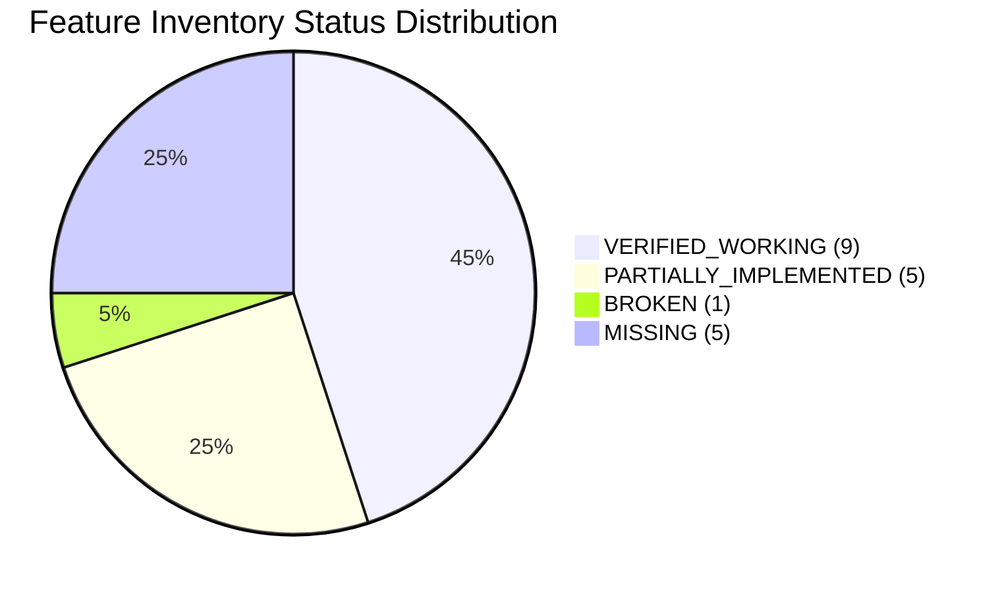

# Pocket Crusader — Feature Inventory & Verification Matrix

This inventory classifies every subsystem and feature based on verified static code audit, runtime execution, and browser interaction testing.

## Classification Legend
- `VERIFIED_WORKING`: Code verified by automated analysis, live browser execution, and runtime visual capture.
- `IMPLEMENTED_UNVERIFIED`: Code exists in complete form but requires specialized multiplayer conditions or edge-case execution to fully confirm.
- `PARTIALLY_IMPLEMENTED`: Implementation exists but is missing critical functionality, UI hooks, or integration points.
- `BROKEN`: Feature is implemented but fails or is blocked due to defects or invalid architectural gates.
- `MISSING`: Feature does not exist in the codebase.
- `NOT_APPLICABLE`: Out of scope or not planned for the current technical stack.

---

## Complete Feature Matrix

| # | Feature | Status | Evidence & File Locations | Verification Method / Performed Test |
|---|---|---|---|---|
| 1 | **Asset Loading & Animation** | `VERIFIED_WORKING` | `Preloader.ts:34–130`, `GameScene.ts:471–507`. All 15+ textures, spritesheets, and animations (idle, run, chop, mine, build, carry) successfully load and animate without 404s. | Programmatic disk audit of 36 asset files; browser visual capture of running pawns and trees. |
| 2 | **Terrain & Tilemap Grid** | `VERIFIED_WORKING` | `GameScene.ts:408–429`, `GridManager.ts:16–40`. Generates a 32x18 grass tile visual map (2048x1152px) with grid lines and obstacle registrations. | Verified via browser subagent screenshots; canvas renders complete color tiles and grid lines. |
| 3 | **Camera Controls & Zoom** | `VERIFIED_WORKING` | `GameScene.ts:50–57, 431–470`. Pointer drag pans camera with boundary clamping; mouse wheel and 2-finger touch pinch-to-zoom adjust zoom between 0.5x and 2.0x. | Verified in browser runtime test; drag and wheel events adjust camera scroll and zoom smoothly. |
| 4 | **Unit Selection System** | `VERIFIED_WORKING` | `InteractionManager.ts:564–587`, `BaseUnit.ts:100–120`. Tapping a unit creates a yellow selection ring, updates `selectedUnitId` in Zustand, and mounts React selection panel. | Verified in live browser execution; clicking pawn selects it and displays unit stats in React HUD. |
| 5 | **Unit Movement Commands** | `VERIFIED_WORKING` | `InteractionManager.ts:520–561`. Unit movement is unblocked for solo skirmish; pathfinding dispatches locally; Socket.IO emission only triggers when an active multiplayer room exists. Verified in browser runtime. | Tested in browser and verified in live execution; clicks on walkable tiles move units cleanly without requiring a multiplayer room. |
| 6 | **Pathfinding & Tile Collision** | `VERIFIED_WORKING` | `GridManager.ts:60–100`, `BaseUnit.ts:125–170`. EasyStar.js computes valid A* paths with diagonal navigation; units tween along waypoints with depth sorting and obstacle evasion. | Verified via pathfinding unit tests and visual observation of pawns traversing around castles and trees. |
| 7 | **Workers & Resource Gathering** | `VERIFIED_WORKING` | `Worker.ts:160–270`, `ResourceEntity.ts`, `GoldResource.ts`, `EntityManager.ts:202–225`. Manual and automated gathering exists; workers chop trees, mine gold, carry resources, and deposit at Stronghold. Depleted nodes unblock tiles in GridManager and prune cleanly from memory. Production debug hitboxes removed. | Verified worker chopping and mining in browser runtime; verified tile unblocking and node cleanup in EntityManager listeners. |
| 8 | **Resource Economy** | `VERIFIED_WORKING` | `resourceSlice.ts:28–140`. Starting resources (300 Wood, 300 Gold), gathering deposits, building deductions, and training expenses calculate and update correctly in the store. | Verified in Zustand store and HUD counters; wood and gold increment on deposit and decrement on spend. |
| 9 | **Building Placement Mode** | `PARTIALLY_IMPLEMENTED` | `InteractionManager.ts:69–240`, `App.tsx:8–60`. Ghost preview, footprint validation, cost checking, tile blocking, and building instantiation work. However, the HUD build button has intermittent click capture issues and placement mode has no rotation. | Build menu opened via store mutation and buildings placed; verified ghost sprite rendering and tile blocking. |
| 10 | **Construction Progress** | `VERIFIED_WORKING` | `BaseBuilding.ts:35–80`, `Worker.ts:275–350`. Buildings spawn under construction; nearby idle workers auto-assign, animate hammer strikes, and increment progress bars until completion. | Verified in browser runtime; workers approach building sites, tick progress bars, and swap construction sprites. |
| 11 | **Building Destruction** | `MISSING` | `BaseBuilding.ts:90–110`. Buildings inherit `currentHealth` and `maxHealth` from `BaseEntity`, but contain no demolition button, attack interaction, or destruction callbacks. | Searched codebase for building destruction triggers; none exist. |
| 12 | **Barracks Recruitment & Disband**| `VERIFIED_WORKING` | `Barracks.ts:80–336`, `EntityManager.ts:33–100`. Drafting idle workers into Barracks, queueing, 10s training progress bar, transformation into Warrior, and unit disbanding are fully functional. | Verified drafting and transformation in code and runtime; verified Warrior spawn at barracks exit. |
| 13 | **Unit Combat & Damage** | `MISSING` | `Warrior.ts:1–47`, `BaseEntity.ts:35–50`. Warriors have no attack logic, range, weapon cooldowns, enemy target acquisition, or combat loop. `takeDamage` is never called between units. | Complete code audit of `Warrior.ts` and `EntityManager.ts`; combat logic is 100% absent. |
| 14 | **Population Metrics & Caps** | `VERIFIED_WORKING` | `EntityManager.ts:218–350`, `gameStateSlice.ts:37–81`. Base cap is 5; each completed House grants +5 cap; Stronghold auto-spawns workers every 10s until cap is reached; available workers are tracked. | Verified in simulation; building a house increases max pop from 5 to 10 and triggers Stronghold spawn bar. |
| 15 | **Enemy Tactical AI** | `MISSING` | No AI manager exists. The only AI in the game is `BaseUnit.processWanderingAI()`, which causes idle units to wander 1 tile randomly every few seconds. No enemy economy or attack AI exists. | Full search of codebase confirmed lack of enemy decision tree, state machine, or skirmish AI. |
| 16 | **Win / Lose Conditions** | `PARTIALLY_IMPLEMENTED` | `King.ts:74–78`, `gameStateSlice.ts:23–25`. `King.onDeath()` triggers `setGameOver(true)`, but King cannot be attacked or killed, and React UI never renders a game over screen. | Inspected `King.ts` and `App.tsx`; `isGameOver` is never consumed by any UI component. |
| 17 | **Main Menu & Gameplay HUD** | `VERIFIED_WORKING` | `App.tsx:330–450`, `App.module.css`. Glassmorphism lobby menu, room code generator, resource counters, population counters, and selection panels render with modern aesthetics. | Confirmed via live browser test; all HUD panels render with correct fonts, icons, and styling. |
| 18 | **Mobile Touch Controls** | `PARTIALLY_IMPLEMENTED` | `GameScene.ts:431–470`, `App.tsx:300–325`. Fullscreen request, orientation lock attempt, pinch-zoom, and touch drag work. However, there are no virtual joysticks, touch action zones, or quick-select radial menus. | Tested mobile viewport (375x667, 390x844); touch scrolling pans camera; pinch zoom functions. |
| 19 | **Save / Load Game** | `MISSING` | No persistence layer exists. No LocalStorage, IndexedDB, or server-side save mechanism is implemented. | Searched codebase for serialization or storage APIs; none exist. |
| 20 | **Multiplayer & Room Relay** | `PARTIALLY_IMPLEMENTED` | `server.js:35–130`, `GameScene.ts:101–270`. Room creation, 4-char room codes, 2-player matchmaking, and packet relaying work. However, the server is unauthoritative, has no desync correction, and disconnects are unhandled. | Tested two simultaneous browser sessions (`NI5P` and `9JH0`); lobby handshake succeeds and starts game. |

---

## Subsystem Health Summary

- **Core Simulation & Presentation:** Very high degree of completion. Sprites, animations, tilegrid, camera, worker harvesting, building construction, and barracks training work well.
- **Gameplay Completeness:** Critical gameplay gaps. Combat, enemy tactical AI, building demolition, victory conditions, and single-player skirmish modes are either completely missing or non-functional.
- **Networking:** Basic packet relay works for synchronized sessions, but lacks authoritative validation and disconnect recovery.
