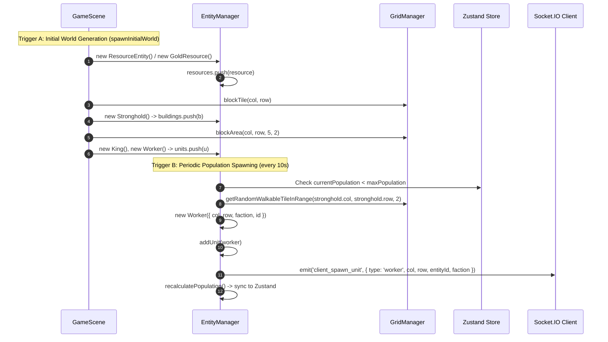
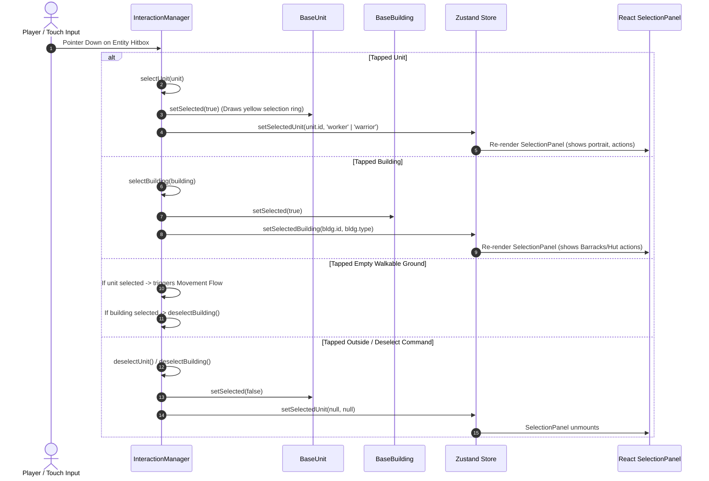
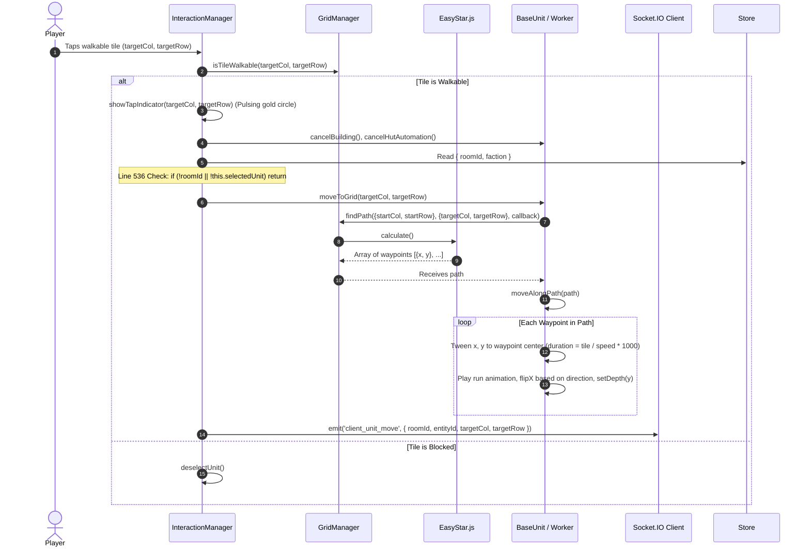
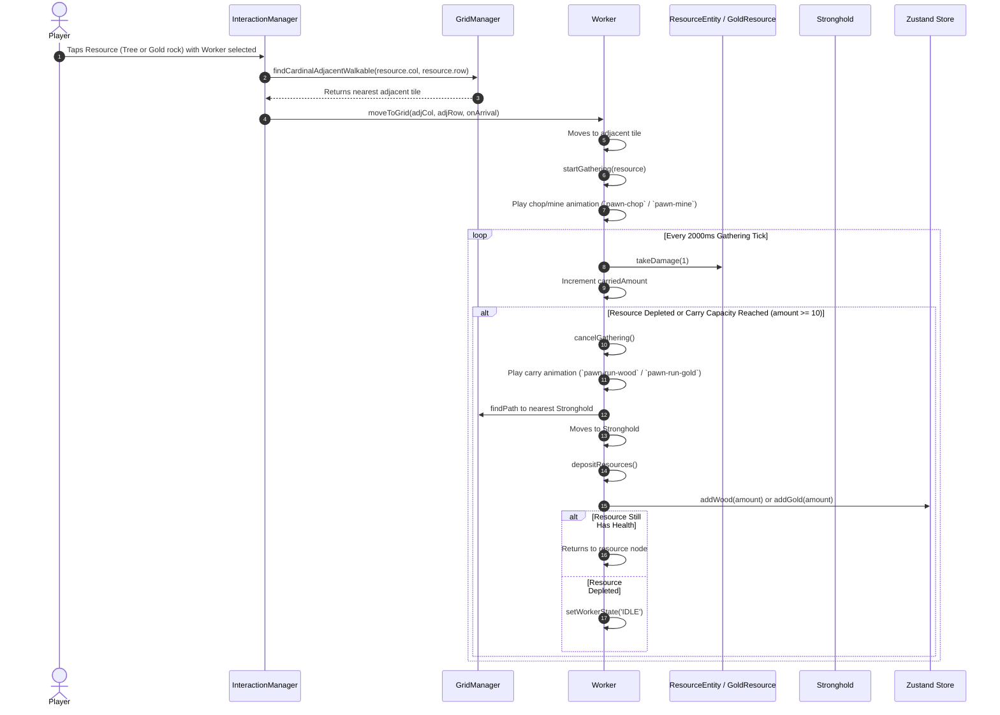
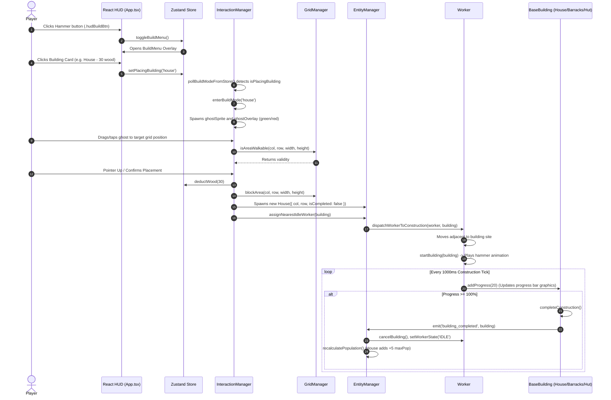
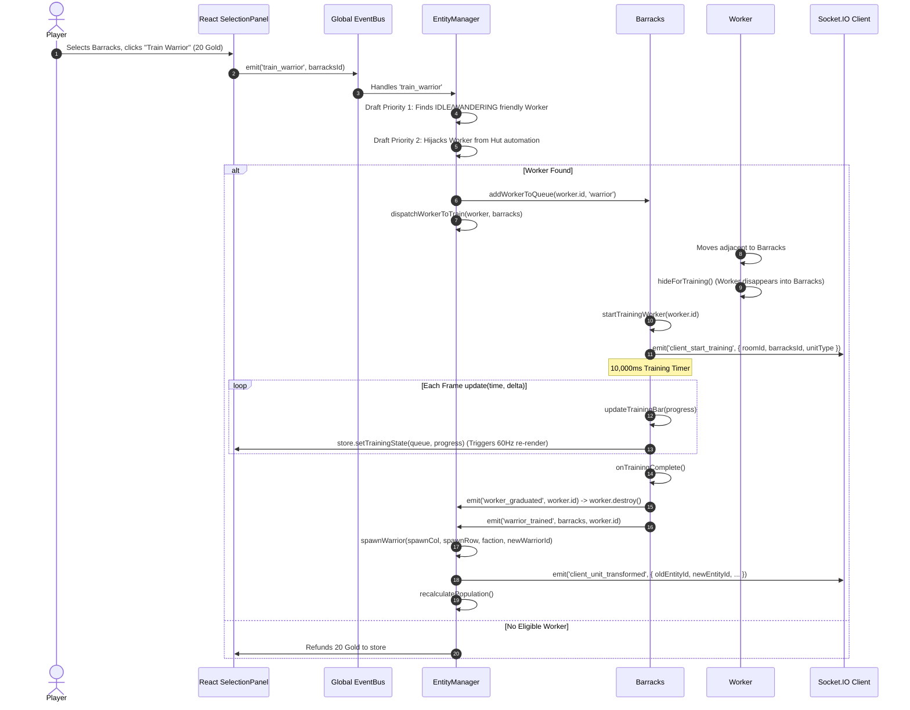
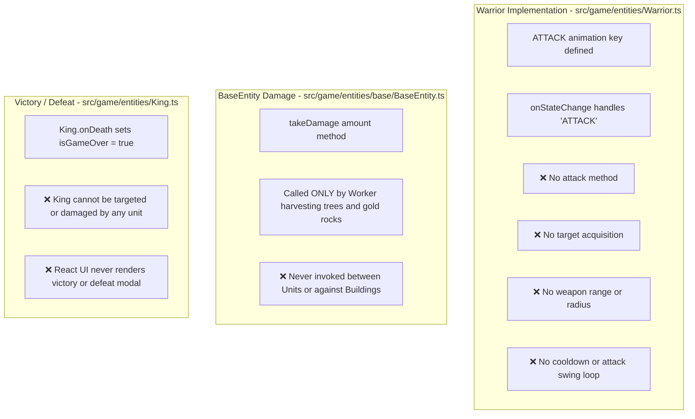
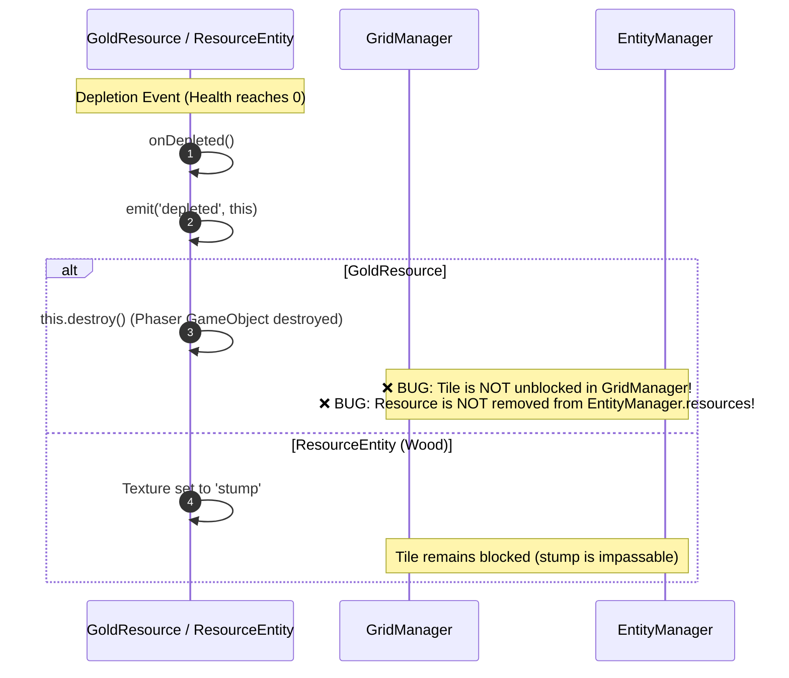
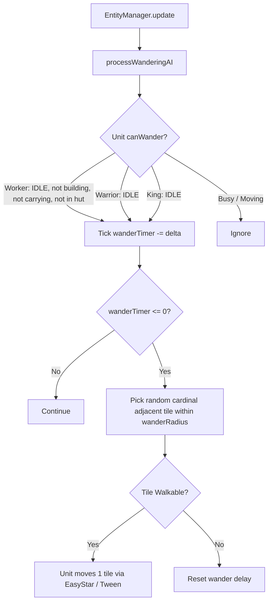

# Pocket Crusader — Gameplay Lifecycle Flows

## 1. Entity Creation & Registration Flow

Pocket Crusader creates entities across three distinct lifecycle triggers: Initial World Generation, Periodic Population Spawning, and Military Recruitment / Construction.

### Trace Details
1. **Initial Spawning (`GameScene.ts:340–404`):**
   - Obstacles (15 trees) and gold rocks (2 nodes) are statically created and pushed to `EntityManager.resources`. Their coordinates are blocked in `GridManager.blockTile()`.
   - Strongholds for Blue (cols 4–8, rows 8–9) and Red (cols 23–27, rows 8–9) are registered via `EntityManager.addBuilding()`. Their footprints are blocked via `GridManager.blockArea(col, row, 5, 2)`.
   - Kings and 3 initial Workers per faction are created and added via `EntityManager.addUnit()`.
2. **Dynamic Worker Spawning (`EntityManager.ts:218–334`):**
   - `EntityManager.update()` increments `spawnTimer += delta`. Every 10,000 ms, if `currentPopulation < maxPopulation`, `checkPopulationAndSpawn()` executes.
   - A walkable tile within radius 2 of the friendly Stronghold is selected.
   - A new `Worker` instance is constructed with a unique timestamp ID (`pawn_${faction}_${Date.now()}`).
   - If connected to multiplayer, `client_spawn_unit` is emitted.
   - `recalculatePopulation()` counts active units and updates Zustand.
3. **Remote Unit Spawning (`GameScene.ts:203–223`):**
   - When receiving `server_spawn_unit`, `GameScene` verifies the entity doesn't already exist in `EntityManager.findUnitById()`, instantiates a remote `Worker`, and pushes it to `EntityManager.units`.

---

## 2. Selection & Deselection Flow

### Trace Details
- **Hitbox Implementation:** Entities inherit from `Phaser.GameObjects.Container` and declare container-local interactive rectangles (`this.setInteractive(new Phaser.Geom.Rectangle(-32, -64, 64, 64), Phaser.Geom.Rectangle.Contains)`).
- **Selection Visuals:** `BaseUnit.setSelected(bool)` creates or clears a procedural yellow ring graphics object around the unit's base (`lineStyle(2, 0xffd700)`).
- **Store Synchronization:**
  - Unit selection calls `useGameStore.getState().setSelectedUnit(unit.id, unitType)`.
  - Building selection calls `useGameStore.getState().setSelectedBuilding(building.id, buildingType)`.
- **Force Deselect Event:** `this.scene.events.on('force_deselect_unit', (unitId) => ...)` handles programmatic deselection when units transform or are disbanded.

---

## 3. Movement & Pathfinding Flow

### Trace Details & Issues
- **Path Calculation:** `BaseUnit.moveToGrid` delegates to `GridManager.findPath`, which utilizes EasyStar with 8-directional movement.
- **Waypoints to Tweens:** `BaseUnit.moveAlongPath()` constructs sequential Phaser tweens. Each tile step animates position linearly and updates facing direction (`this.mainSprite.flipX = targetPixel.x < this.x`).
- **Single-Player Movement Blocker (`InteractionManager.ts:536–538`):**
  The click handler strictly requires `if (!roomId || !this.selectedUnit) return;`. In single-player or offline mode without an active room ID, ground move clicks abort immediately, preventing units from moving.

---

## 4. Resource Gathering Flow

### Trace Details & Automated Huts
- **Manual Gathering (`Worker.ts:160–250`):**
  - Workers travel to cardinal adjacent tiles (up/down/left/right) next to the target resource.
  - A repeating Phaser timer (`scene.time.addEvent({ delay: 2000, repeat: -1 })`) deals damage to the resource (`res.takeDamage(1)`) and accumulates resources.
  - Once full (or when the node breaks), the worker navigates to the friendly Stronghold, deposits the goods into Zustand, and loops back if the node remains valid.
- **Automated Huts (`EntityManager.ts:528–552`, `BuildingEntity.ts`):**
  - When a Woodcutter's Hut or Gold Hut is constructed, `EntityManager.dispatchWorkerToHut()` assigns an idle worker to the hut.
  - The worker continuously gathers nearby trees or gold within an automated patrol radius without requiring player clicks.

---

## 5. Construction Flow

### Trace Details
- **Build Mode State:** Managed via `InteractionManager.isBuildMode` and driven by `useGameStore.isPlacingBuilding`.
- **Cost Validation:** Checked in React `BuildMenu` component (`canAffordHouse = wood >= 30`) and verified again during placement in `InteractionManager.handleBuildPlacement()`.
- **Progress Tracking:** Buildings display an overhead progress bar (`constructionBarBg`, `constructionBarFill`). Each second, assigned workers add progress until `completeConstruction()` switches the sprite from `House_Construction.png` to `House1.png`.

---

## 6. Training and Recruitment Flow

### Trace Details
- **Drafting Mechanic:** Instead of spawning units from thin air, training requires drafting an existing physical `Worker` entity from the field.
- **Queue Synchronization:** The Barracks maintains an array of queued recruits (`trainingRecruits: { workerId, unitType, status }[]`).
- **Graduation Transition:** The worker is hidden during training, then destroyed upon completion. A new `Warrior` instance is spawned adjacent to the Barracks entrance.

---

## 7. Combat, Damage & Unit Lifecycle (Audited Gap)

### Audited Finding: Combat System Does Not Exist

Tracing all combat-related code across the repository reveals:

1. **Warrior Attack Capabilities:**
   `Warrior.ts` contains only 47 lines of code. It configures health (200), speed (130), and an animation switcher for `'ATTACK'`, but contains zero combat methods, targeting logic, attack commands, or damage application.
2. **Targeting & Interaction:**
   `InteractionManager.ts` has no branch for right-clicking or tapping an enemy unit to issue an attack command. Tapping an enemy unit merely attempts to select it.
3. **King Lifecycle:**
   `King.ts` defines `onDeath()` which sets `useGameStore.getState().setGameOver(true)`. However, no system in the game is capable of attacking the King, reducing his health, or triggering this death callback. Furthermore, `App.tsx` never reads or renders `isGameOver`.

---

## 8. Death, Destruction & Resource Cleanup Flow

### Trace Details & Confirmed Memory Leak
- `GoldResource.onDepleted()` destroys the Phaser game object (`this.destroy()`).
- However, `EntityManager.resources` never removes the destroyed object.
- Each subsequent frame, `EntityManager.update()` iterates over the array and attempts to call `resource.update(time, delta)` on destroyed instances.
- Furthermore, `GridManager.unblockTile(col, row)` is never called for depleted gold nodes, leaving the grid cell permanently impassable.

---

## 9. Wandering AI Flow

### Trace Details
- Implemented in `BaseUnit.ts` and ticked in `EntityManager.processWanderingAI()`.
- Provides ambient life by having idle pawns, warriors, and kings occasionally step 1 tile in a random direction after a randomized cooldown (Workers: 5–10s, Warriors: 8–15s, King: 15–20s).
