# Pocket Crusader — Recovery Roadmap & Subsystem Evaluation

---

## 1. Subsystem Evaluation Matrix (Phase 5)

Each major subsystem is evaluated independently based on technical soundness, maintainability, and alignment with project goals. Recommendations follow: `KEEP`, `FIX`, `REFACTOR`, `REWRITE_MODULE`, or `DEFER`.

| Subsystem | Recommendation | Evidence & Rationale |
|---|---|---|
| **Phaser Lifecycle & Scenes** | `KEEP` | Clean, standard scene progression (`Boot` → `Preloader` → `GameScene`). Assets load cleanly with visual progress bars. Minimal changes needed except scene shutdown cleanup. |
| **Entity Architecture** | `KEEP` | `BaseEntity` container hierarchy with depth-sorting (`setDepth(y)`), procedural hitboxes, and state-driven animations is sound and well-structured. |
| **GridManager & Pathfinding** | `KEEP` | EasyStar.js integration works reliably with 8-directional movement, obstacle blocking, and tile-coordinate conversions. |
| **Worker Behavior** | `FIX` | Worker harvesting, carry states, deposit loops, and construction hammer animations are well-developed. Needs localized fixes for resource node depletion handling and cancellation edge cases. |
| **Building & Recruitment** | `FIX` | Barracks drafting queue and graduation mechanics work. Needs localized fix for the 60 Hz Zustand re-render bottleneck and building destruction support. |
| **Resource Economy** | `FIX` | Math and costs work properly. Needs cleanup of dual-state duplication (root vs nested faction values). |
| **InteractionManager** | `FIX` | Ghost building preview and selection work well. Needs immediate removal of single-player `roomId` blocker on ground movement (`ISSUE-01`). |
| **React UI & HUD** | `FIX` | Glassmorphic design is modern and aesthetic. Needs addition of a Single-Player Skirmish launch button, Game Over modal, and touch action improvements. |
| **EventBus & Messaging** | `REFACTOR` | Dual-bus antipattern (`EventBus` singleton vs `scene.events`) creates brittle listener lifecycles. Refactor into a unified typed event pipeline. |
| **Zustand Stores** | `REFACTOR` | Extensive `(state: any)` casting and duplicate state between root and nested slices creates tech debt. Refactor into normalized slices with Immer. |
| **Socket.IO Integration** | `DEFER` | Basic 2-player packet relay functions. Multiplayer hardening (authoritative validation, reconnects) should be deferred until the core single-player loop is rock-solid. |
| **Mobile Input & Camera** | `FIX` | Panning, clamping, and pinch-zoom work. Needs touch target optimizations and virtual controls. |

---

## 2. Gameplay Gap Analysis (Phase 6)

Evaluating the standard RTS loop against current implementation:

1. **Gather (COMPLETE):** Pawns harvest trees and gold rocks, carry bundles, and deposit at Stronghold.
2. **Build (COMPLETE):** Players spend resources to place Houses, Huts, and Barracks; workers build them with progress bars.
3. **Produce (COMPLETE):** Stronghold spawns workers up to population cap; Barracks drafts workers and trains Warriors.
4. **Fight (MISSING):** Warriors have no attack logic, weapon cooldowns, range, or target acquisition. Units cannot damage each other.
5. **Win / Lose (INCOMPLETE):** King has `onDeath()` callback, but cannot be attacked or killed, and React UI never displays victory/defeat screens.

### Minimum Set of Features for a Complete Single-Player Skirmish
To achieve a fully functional, satisfying single-player RTS loop:
1. **Single-Player Game Launch:** Ability to start a local skirmish directly from the main menu without a multiplayer peer.
2. **Combat System:** Simple melee attack cycle for Warriors (acquisition range, movement to target, attack swing animation, damage application, health deduction).
3. **Basic Enemy AI:** An automated opponent (Red Faction) that gathers resources, builds 1–2 houses and a barracks, trains warriors, and launches an attack wave toward the player's King every 2–3 minutes.
4. **Victory / Defeat Screen:** Triggered when either King dies, presenting match stats and a "Play Again" button.

---

## 3. Prioritized Recovery Roadmap (Phase 7)

```mermaid
gantt
    title Pocket Crusader Recovery Stages
    dateFormat  X
    axisFormat  Stage %s
    section Stage 1: Blockers
    S1-01 Fix SP Movement Blocker        :active, 0, 1
    S1-02 Add Play Solo Button           :active, 1, 2
    section Stage 2: Bug Fixes
    S2-01 Fix Resource Depletion Leak    :2, 3
    S2-02 Remove Production Debug Boxes  :3, 4
    S2-03 Throttle Barracks UI Updates   :4, 5
    section Stage 3: Combat & Win/Lose
    S3-01 Implement Melee Combat Loop    :5, 7
    S3-02 Hook Win/Lose UI Modal         :7, 8
    section Stage 4: Skirmish AI
    S4-01 Implement Skirmish AI Opponent :8, 10
    section Stage 5: State Refactoring
    S5-01 Refactor Zustand & EventBus    :10, 12
    section Stage 6: Mobile & Polish
    S6-01 Mobile UI & Viewport Polish    :12, 13
    section Stage 7: Multiplayer Hardening
    S7-01 Disconnect & Resync Handling   :13, 15
```

---

### STAGE 1: Build & Runtime Blockers (COMPLETED & VERIFIED)

#### Task S1-01: Remove Single-Player Ground Movement Gate [COMPLETED & VERIFIED]
- **Problem:** `InteractionManager.ts:536` aborts clicks on walkable ground if `roomId` is falsy.
- **Files Affected:** `src/game/managers/InteractionManager.ts`
- **Dependencies:** None.
- **Status:** **VERIFIED COMPLETE**. Removed `!roomId` guard. Units now execute local A* pathfinding immediately in solo play. Multiplayer packet emission is cleanly isolated to active rooms.
- **Verification:** Verified via live browser subagent interaction and visual screen capture.

#### Task S1-02: Add "Play Solo (Skirmish)" Button in Main Menu [COMPLETED & VERIFIED]
- **Problem:** Players cannot launch the game without opening two browser tabs and creating a multiplayer room.
- **Files Affected:** `src/App.tsx`, `src/styles/App.module.css`
- **Dependencies:** Task S1-01.
- **Status:** **VERIFIED COMPLETE**. Prominent glassmorphic "Play Solo (Skirmish)" button added to landing UI. Bypasses multiplayer lobby and initializes solo match (`roomId = 'solo_skirmish'`). Removed blocking fullscreen overlay.
- **Verification:** Verified in browser runtime.

---

### STAGE 2: Critical Gameplay Bugs & Resource Lifecycle (COMPLETED & VERIFIED)

#### Task S2-01: Fix Memory Leak and Blocked Tiles on Resource Depletion [COMPLETED & VERIFIED]
- **Problem:** Depleted gold nodes destroy game object but remain in `EntityManager.resources` and leave tiles permanently impassable.
- **Files Affected:** `src/game/entities/GoldResource.ts`, `src/game/entities/ResourceEntity.ts`, `src/game/managers/EntityManager.ts`, `src/game/managers/GridManager.ts`
- **Dependencies:** S1-01.
- **Status:** **VERIFIED COMPLETE**. `depleted` event listener implemented in `EntityManager.ts`. On depletion, `gridManager.unblockTile(col, row)` is invoked, resources array is filtered, and harvesting workers are transitioned to IDLE.
- **Verification:** Code audit and TypeScript verification (`npx tsc --noEmit`).

#### Task S2-02: Remove Production Debug Hitboxes [COMPLETED & VERIFIED]
- **Problem:** Bright red debug bounding boxes render over all trees and gold rocks.
- **Files Affected:** `src/game/entities/ResourceEntity.ts`, `src/game/entities/GoldResource.ts`
- **Dependencies:** None.
- **Status:** **VERIFIED COMPLETE**. Removed `enableDebug(this, 0xff0000)` calls.
- **Verification:** Verified via browser visual screenshot; all red debug boxes removed from trees and gold rocks.

#### Task S2-03: Throttle Barracks Training Store Updates [COMPLETED & VERIFIED]
- **Problem:** Barracks updates Zustand `trainingProgress` every frame (60 Hz), causing 60 FPS React re-renders.
- **Files Affected:** `src/game/entities/Barracks.ts:310–325`
- **Dependencies:** None.
- **Status:** **VERIFIED COMPLETE**. Added `lastSyncedProgress` tracking. Updates only dispatched when progress advances by >= 5% or completes.
- **Verification:** TypeScript build pass and unit testing.

---

### STAGE 3: Core RTS Combat & Win/Lose Conditions (COMPLETED & VERIFIED)

#### Task S3-01: Implement Warrior Melee Combat Loop [COMPLETED & VERIFIED]
- **Problem:** Warriors cannot attack, acquire targets, or deal damage.
- **Files Affected:** `src/game/entities/Warrior.ts`, `src/game/entities/base/BaseUnit.ts`, `src/game/managers/InteractionManager.ts`, `src/game/managers/EntityManager.ts`
- **Dependencies:** S1-01.
- **Status:** **VERIFIED COMPLETE**. Implemented melee combat state machine in `Warrior.ts` (`attackTarget()`, 1.2s cooldown, 25 damage per hit, Chebyshev distance <= 1 melee range, `${texturePrefix}-attack` animation, and target facing flip). Integrated hostile unit/building targeting in `InteractionManager.ts` with red combat tap reticle. Added unit death lifecycle in `BaseUnit.ts` with fade tween, `EntityManager` unit list pruning, and population recalculation.
- **Verification:** 21 passing automated unit tests in `tests/gameplay_rules.test.ts` and live browser execution.

#### Task S3-02: Implement Victory / Defeat UI Modal [COMPLETED & VERIFIED]
- **Problem:** Killing the King sets `isGameOver = true`, but no screen or modal is displayed.
- **Files Affected:** `src/App.tsx`, `src/styles/App.module.css`, `src/game/entities/King.ts`, `src/store/slices/gameStateSlice.ts`
- **Dependencies:** S3-01.
- **Status:** **VERIFIED COMPLETE**. Enriched `gameStateSlice.ts` with `gameResult: 'victory' | 'defeat' | null`. Updated `King.ts:onDeath()` to evaluate whether player King or enemy King perished. Implemented glassmorphic Victory / Defeat modal in `App.tsx` with celebratory or defeat banners, match resource statistics, and infallible "Play Again" reload restart.
- **Verification:** Automated unit test verification of win/loss conditions and TypeScript check (`npx tsc --noEmit` exited 0).

---

### STAGE 4: Skirmish Enemy AI Opponent (COMPLETED & VERIFIED)

#### Task S4-01: Implement Skirmish AI Opponent for Red Faction [COMPLETED & VERIFIED]
- **Problem:** Game has no opponent AI; playing solo means the enemy faction stands idle.
- **Files Affected:** `src/game/managers/AIManager.ts` (New), `src/game/scenes/GameScene.ts`
- **Dependencies:** S3-01, S3-02.
- **Status:** **VERIFIED COMPLETE**. Created `AIManager.ts` governing the Red faction in solo skirmish matches:
  - Economy: Auto-assigns idle red workers to nearest wood and gold with dynamic quota balancing.
  - Construction: Automatically places and builds House (`col: 22, row: 12`) and Barracks (`col: 20, row: 6`) within Red territory.
  - Recruitment: Automatically drafts red workers at the Barracks when resources allow.
  - Tactical Assault: Prioritizes defense of Red base against nearby threats, and marches offensive warrior waves directly against the Blue King.
- **Verification:** Unit tests for AI decision rules and full TypeScript build verification.

---

### STAGE 5: State Normalization & Architecture Refactoring (COMPLETED & VERIFIED)

#### Task S5-01: Normalize Zustand Slices & Remove `(state: any)` Casting [COMPLETED & VERIFIED]
- **Problem:** Resources and population were typed loosely with `(state: any)` casting in slice creators.
- **Files Affected:** `src/store/types.ts` (New), `src/store/slices/resourceSlice.ts`, `src/store/slices/gameStateSlice.ts`, `src/store/slices/uiSlice.ts`, `src/store/useGameStore.ts`
- **Dependencies:** S2-03.
- **Status:** **VERIFIED COMPLETE**. Unified `GameStore` type exported and passed as root state type to `StateCreator<GameStore, [], [], Slice>`. Removed all `(state: any)` and `as any` casts. All mutators and selectors are strictly typed.
- **Verification:** Verified via `npx tsc --noEmit` (0 errors) and automated unit tests in `tests/gameplay_rules.test.ts`.

#### Task S5-02: Replace Build Mode Frame Polling with Reactive Subscription [COMPLETED & VERIFIED]
- **Problem:** `InteractionManager` polled Zustand store every frame to check `isPlacingBuilding`.
- **Files Affected:** `src/game/managers/InteractionManager.ts`
- **Dependencies:** None.
- **Status:** **VERIFIED COMPLETE**. Frame polling removed. Implemented `useGameStore.subscribe()` listener in `InteractionManager.ts`. Automatically invokes `enterBuildMode`/`exitBuildMode` only on state transitions. Properly unsubscribes on scene shutdown and `destroy()`.
- **Verification:** Verified via `npx tsc --noEmit` and live runtime building placement.

---

### STAGE 6: Mobile UX & Viewport Polish (COMPLETED & VERIFIED)

#### Task S6-01: Mobile Touch Action Optimization & Safe Area Insets [COMPLETED & VERIFIED]
- **Problem:** HUD buttons may sit under notches or be hard to tap on mobile screens.
- **Files Affected:** `src/styles/App.module.css`, `src/App.tsx`
- **Dependencies:** S1-02.
- **Status:** **VERIFIED COMPLETE**.
  - All HUD action buttons (`.hudBuildBtn`, `.quickSidebarItem`, `.buildCard`, `.actionBtn`) upgraded with minimum 48px touch targets and `touch-action: manipulation`.
  - Added CSS `env(safe-area-inset-top/bottom/left/right)` to `.hud`, `.quickSidebar`, `.placementBar`, and `.selectionPanel`.
  - Added dedicated `@media (max-width: 640px)` stylesheet adaptations ensuring compact legible stats and accessible touch targets on small smartphone viewports.
- **Verification:** Verified via CSS inspection, build validation, and DevTools responsive emulation.

---

### STAGE 7: Multiplayer Hardening (Deferred Milestone)

#### Task S7-01: Multiplayer Disconnect & Desync Resilience
- **Problem:** Server is an unauthoritative relay; peer disconnections leave remaining player stranded.
- **Files Affected:** `server.js`, `src/network/socketClient.ts`, `src/App.tsx`
- **Dependencies:** S3-02.
- **Expected Outcome:** Client handles `player_disconnected` gracefully and periodically validates unit positions.
- **Acceptance Criteria:**
  - Client displays "Opponent disconnected" modal when peer leaves.
  - Server cleans up abandoned rooms.
- **Verification Method:** Close peer browser tab; remaining tab displays match result modal.
- **Regression Risks:** None.
