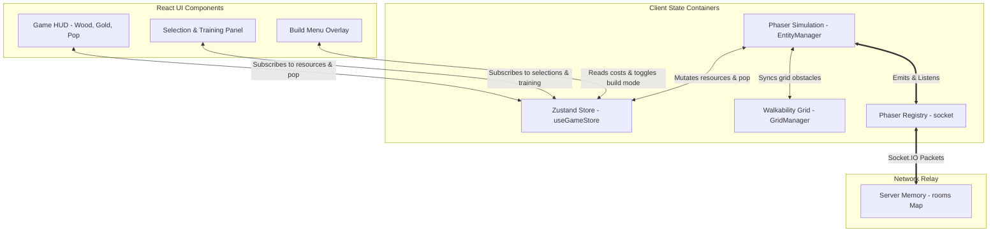
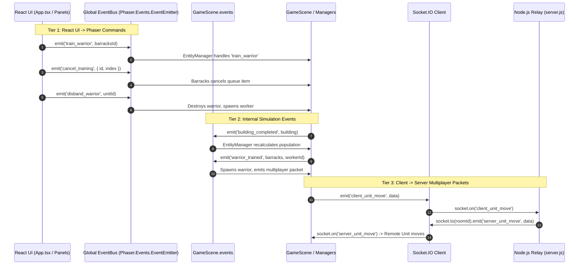

# Pocket Crusader — State & Event Flow Analysis

## 1. System State Architecture & Stores

The application distributes state across four distinct domains:
1. **React / Zustand Store (`src/store/useGameStore.ts`):** Client-side reactive UI state, resources, population, and active selections.
2. **Phaser Game Engine Memory (`GameScene`, `EntityManager`, `GridManager`):** Active simulation entities, coordinate grids, pathfinding graphs, and visual sprites.
3. **Phaser Registry (`game.registry`):** Cross-scene shared objects (e.g. active Socket.IO client instance).
4. **Node.js Server Memory (`server.js`):** In-memory Map of active rooms and player socket mappings.



---

## 2. State Ownership & Mutation Matrix

| State Variable | Primary Storage Location | Authoritative Owner | Mutating Systems | UI Trigger Mechanism | Duplication & Inconsistency Risks |
|---|---|---|---|---|---|
| **Wood** | Zustand `resourceSlice` (`resources[faction].wood`) | Client Simulation | `Worker.depositResources()`, `InteractionManager.handleBuildPlacement()`, `resourceSlice.addWood/deductWood` | React selector `state.resources[faction]` triggers HUD re-render | **High Risk:** Duplicated at root (`state.wood`) and nested (`state.resources[faction].wood`). Deductions without explicit faction update default to `state.faction`. |
| **Gold** | Zustand `resourceSlice` (`resources[faction].gold`) | Client Simulation | `Worker.depositResources()`, `SelectionPanel.handleTrainWarrior()`, `EntityManager.dispatchWorkerToTrain()` (refund), `resourceSlice.addGold/deductGold` | React selector `state.resources[faction]` triggers HUD re-render | **High Risk:** Duplicated at root (`state.gold`) and nested (`state.resources[faction].gold`). Both locations updated asynchronously. |
| **Current Population** | Zustand `gameStateSlice` & `resourceSlice` | `EntityManager` | `EntityManager.recalculatePopulation()`, `checkPopulationAndSpawn()` | React selector `state.resources[faction].currentPopulation` | **High Risk:** Stored in four places: `gameStateSlice.currentPopulation`, `resourceSlice.blue.currentPopulation`, `resourceSlice.red.currentPopulation`, and physical length of `EntityManager.units`. |
| **Max Population** | Zustand `gameStateSlice` & `resourceSlice` | `EntityManager` | `EntityManager.recalculatePopulation()` based on completed House count (5 base + 5 per house) | React selector `state.resources[faction].maxPopulation` | **Medium Risk:** Duplicated at root and inside nested faction objects. |
| **Worker / Warrior Counts** | Zustand `gameStateSlice` & `resourceSlice` | `EntityManager` | `EntityManager.recalculatePopulation()` | React selector `state.resources[faction].workerCount/warriorCount` | **Medium Risk:** Duplicated across root and nested slices. |
| **Faction Assignment** | Zustand `gameStateSlice.faction` | Server (`server.js` room handshake) | `App.tsx` on `room_created` (blue) or `room_joined` (red) | Passed down to Phaser and components | **Low Risk:** Assigned once during matchmaking handshake. |
| **Room ID** | Zustand `gameStateSlice.roomId` | Server (`server.js`) | `App.tsx` on `room_created` / `room_joined` | Drives single-player vs multiplayer gates | **Critical Blocker:** Absence of `roomId` blocks ground movement in `InteractionManager:536`. |
| **Selected Unit ID & Type** | Zustand `uiSlice` (`selectedUnitId`, `selectedUnitType`) | `InteractionManager` | `InteractionManager.selectUnit()`, `deselectUnit()`, `scene.events.on('force_deselect_unit')` | React selector triggers `SelectionPanel` render | **Medium Risk:** Stored in both `InteractionManager.selectedUnit` reference and Zustand string ID. |
| **Selected Building ID & Type** | Zustand `uiSlice` (`selectedBuildingId`, `selectedBuildingType`) | `InteractionManager` | `InteractionManager.selectBuilding()`, `deselectBuilding()` | React selector triggers `SelectionPanel` render | **Medium Risk:** Stored in both `InteractionManager` internal property and Zustand string ID. |
| **Build Mode (`isPlacingBuilding`)** | Zustand `uiSlice` (`isPlacingBuilding`) | React UI / User | React `BuildMenu`, `InteractionManager.enterBuildMode()`, `exitBuildMode()` | Polled at 60 FPS in `InteractionManager.pollBuildModeFromStore()` | **Architectural Antipattern:** Polled in update loop instead of event/reactive dispatch. |
| **Construction Progress** | `BaseBuilding.constructionProgress` | Physical Building Instance | `Worker` construction ticks (`building.addProgress(20)`) | Procedural Phaser Graphics (`constructionBarFill`) | **Low Risk:** Progress stays within Phaser engine; no unnecessary React re-renders. |
| **Recruitment Queue & Progress** | `Barracks.trainingRecruits` & Zustand `uiSlice` | Physical Barracks Instance | `Barracks.addWorkerToQueue()`, `startTrainingWorker()`, `cancelQueueItem()` | Synced to Zustand `trainingProgress` every frame (60 Hz) | **High Performance Risk:** Ticking `setTrainingState()` every frame triggers 60 FPS React re-renders. |
| **Entity Health & Status** | `BaseEntity.currentHealth`, `maxHealth` | Physical Entity Instance | `Worker` harvesting ticks (`res.takeDamage(1)`), `GoldResource.takeDamage()` | Procedural Phaser graphics | **Low Risk:** Local to Phaser; no combat exists to mutate unit health. |
| **Walkability Grid** | `GridManager.grid` 2D array | `GridManager` | `blockTile()`, `unblockTile()`, `blockArea()`, `unblockArea()` | None (internal pathfinding representation) | **High Bug Risk:** Depleted resources do not unblock tiles, leaving permanent phantom obstacles. |

---

## 3. Event Mapping: Cross-System Event Bus Topology

Communication between React, Phaser, and Socket.IO relies on a multi-tiered event pipeline:



### Complete Socket Event Catalog

| Packet Name | Direction | Payload | Processing Handler | Authoritative Check on Server? |
|---|---|---|---|---|
| `create_room` | Client → Server | `roomId: string` | `server.js:40` | Assigns host, joins room |
| `join_room` | Client → Server | `roomId: string` | `server.js:49` | Max 2 players limit check |
| `room_ready` | Server → Client | `{ roomId, players }` | `App.tsx:244` | None (triggers game start) |
| `client_unit_move` | Client → Server | `{ roomId, entityId, targetCol, targetRow }` | `server.js:64` | **None** (blind relay to `server_unit_move`) |
| `server_unit_move` | Server → Peer | `{ entityId, targetCol, targetRow }` | `GameScene.ts:107` | Finds remote unit and executes local pathfinding |
| `client_build_structure` | Client → Server | `{ roomId, type, col, row, entityId, faction }` | `server.js:69` | **None** (blind relay to `server_build_structure`) |
| `server_build_structure` | Server → Peer | `{ type, col, row, entityId, faction }` | `GameScene.ts:250` | Spawns remote building entity |
| `client_spawn_unit` | Client → Server | `{ roomId, type, col, row, entityId, faction }` | `server.js:74` | **None** (blind relay to `server_spawn_unit`) |
| `server_spawn_unit` | Server → Peer | `{ type, col, row, entityId, faction }` | `GameScene.ts:204` | Spawns remote worker entity |
| `client_unit_transformed` | Client → Server | `{ roomId, oldEntityId, newEntityId, type, col, row, faction }` | `server.js:79` | **None** (blind relay to `server_unit_transformed`) |
| `server_unit_transformed` | Server → Peer | `{ oldEntityId, newEntityId, ... }` | `GameScene.ts:226` | Destroys remote pawn, spawns remote warrior |
| `client_start_gathering` | Client → Server | `{ roomId, entityId, resourceX, resourceY, resourceType }` | `server.js:84` | **None** (blind relay) |
| `client_resource_depleted` | Client → Server | `{ roomId, resourceX, resourceY, amount }` | `server.js:89` | **None** (blind relay) |
| `client_start_training` | Client → Server | `{ roomId, barracksId, unitType }` | `server.js:99` | **None** (blind relay) |
| `client_start_constructing`| Client → Server | `{ roomId, entityId, buildingId }` | `server.js:109` | **None** (blind relay) |
| `player_disconnected` | Server → Peer | `{ id }` | `server.js:121` | **Unhandled by Client** (dead event) |

---

## 4. State Duplication & Desynchronization Risks

### 1. Dual Resource State in Zustand
In `src/store/slices/resourceSlice.ts`:
- Root level contains: `state.wood: number` and `state.gold: number`.
- Nested level contains: `state.resources.blue` and `state.resources.red`.
- When `addWood(amount)` is called without an explicit faction argument:
  ```typescript
  const targetFaction = faction || state.faction || 'blue';
  const newResources = { ...state.resources, [targetFaction]: { wood: state.resources[targetFaction].wood + amount } };
  return { resources: newResources, wood: newResources[localFaction].wood };
  ```
  If `state.faction` is not set or misaligned, the root values and nested faction values drift out of sync.

### 2. Duplicated Population Metrics
Population numbers exist simultaneously in:
- `gameStateSlice.currentPopulation`, `maxPopulation`, `workerCount`, `warriorCount`, `availableWorkersCount`.
- `resourceSlice.blue.*` and `resourceSlice.red.*`.
- The live object array `EntityManager.units`.
Any delay or discrepancy in `EntityManager.recalculatePopulation()` causes UI counters to mismatch actual units present on the grid.

### 3. Multiplayer Peer Simulation Drift
Because `server.js` does not run an authoritative game simulation:
- **Local Pathfinding Differences:** `client_unit_move` sends `(targetCol, targetRow)`. The receiving client calculates the path locally using its local EasyStar instance. If a building or unit occupies a tile on one client but not the other, the two clients calculate different paths and the unit ends up in different locations.
- **Timer Skew:** Gathering ticks and training timers run on local client clocks. Timer drift causes resources to deplete earlier on one peer than another.
- **Race Conditions:** Two players can attempt to build or gather on the same tile simultaneously without server arbitration.
