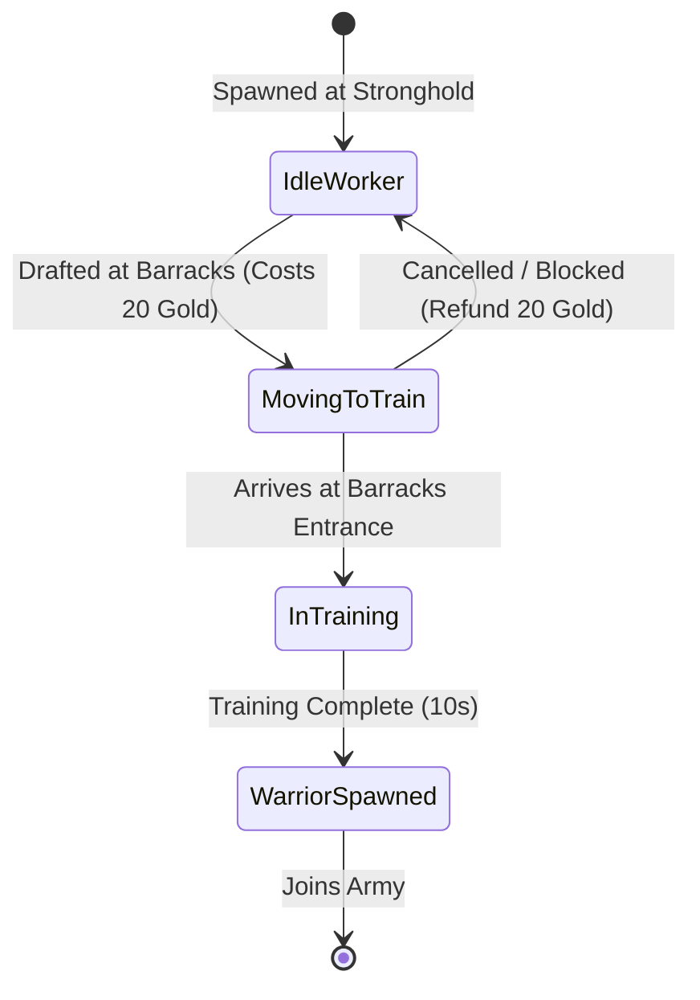

# Pocket Crusader — Gameplay Balance & Economy Design

**Status:** Authoritative Specification  
**Author:** Antigravity Systems Team (RTS Systems & Balance Lead)  
**Target:** Skirmish Solo Play & Mobile RTS Loop  

---

## 1. Executive Balance Philosophy

The core problem with the current single-player skirmish experience is **erratic pacing, extreme premature AI aggression, and unbalanced economic ramp-up**:
1. **Premature AI Attack:** The AI attacks the moment it produces a single warrior (often within 30–45 seconds), marching across a tiny 32×18 map directly to the player's King. This forces the player into a single panicked defensive response rather than allowing RTS base building, economy development, and tactical decision-making.
2. **Economic Disconnect:** Starting resources (300 Wood, 300 Gold) are artificially inflated, circumventing the early-game gathering loop, yet Stronghold worker spawning occurs every 10 seconds for free, leading to rapid population cap saturation without strategic investment.
3. **Asymmetric AI Spawning:** Spawning in `EntityManager.ts` only ticks for `localFaction` (`store.faction || 'blue'`). The AI Red faction was never legitimately spawning new workers from its Stronghold, relying instead on initial units and whatever it started with.
4. **Binary Combat & Lack of Unit Depth:** Warriors deal 25 damage every 1.2s against 500 HP Kings and 200 HP units. Combat lacks target prioritization, ranged options, tactical positioning, or retreat thresholds.

---

## 2. RTS Economy Redesign

### 2.1 Starting Conditions & Resource Thresholds

To establish a strategic progression curve (Opening → Expansion → Fortification → Army Production → Climax), starting resources and costs must provide meaningful choices (e.g., fast barracks rush vs. economic expansion with houses and extra workers).

| Resource / Entity | Old Value | Redesigned Baseline | Design Rationale |
|---|---|---|---|
| **Starting Wood** | 300 | **100** | Enough for 1 House (40) + 1 Woodcutter Hut (40) or Barracks (60) with initial chopping. |
| **Starting Gold** | 300 | **60** | Enough to build an initial Barracks (40 gold) and draft 1 Warrior (20 gold). |
| **Starting Workers** | 3 Workers + 1 King + 1 Warrior | **3 Workers + 1 King** (No initial Warrior) | Forces both player and AI to build infrastructure before military conflict. |
| **Worker Harvest Rate (Wood)** | 5 per 1.5s hit (cap 10) | **5 per 1.5s hit (carry cap 10)** | 2 hits = 10 wood per return trip (~6-8s round trip). |
| **Worker Harvest Rate (Gold)** | 10 per 2.0s hit (cap 10) | **5 per 2.0s hit (carry cap 10)** | Gold is rarer and slightly slower to mine than wood. |
| **Tree Node HP / Yield** | 3 HP (15 wood total) | **6 HP (30 wood total)** | Reduces rapid node exhaustion while encouraging expansion to outer clusters. |
| **Gold Rock HP / Yield** | 60 HP (60 gold total) | **10 HP (50 gold total)** | Deep nodes provide steady economy throughout the match. |

### 2.2 Building Costs & Construction Progression

| Structure | Footprint | Wood Cost | Gold Cost | Build Time (1 Worker) | Function & Utility |
|---|---|---|---|---|---|
| **House** | 2×2 | 40 | 0 | 12s | Increases maximum population by +5. Max 5 houses (30 pop cap). |
| **Woodcutter Hut** | 1×1 | 40 | 0 | 10s | Drops off wood locally; automated worker station. |
| **Gold Hut** | 1×1 | 40 | 0 | 10s | Drops off gold locally; automated mining station. |
| **Barracks** | 2×2 | 60 | 40 | 18s | Trains Pawns into Warriors (and Archers if enabled). |
| **Stronghold** | 5×2 | N/A (HQ) | N/A (HQ) | Starting HQ | Universal drop-off; spawns new Pawns; base defense rally point. |

---

## 3. Stronghold Pawn Spawning & Population Management

### 3.1 Spawning Rules & Cadence

1. **Configurable Spawning Cadence:**
   - Baseline interval: **20.0 seconds** (previously 10.0 seconds).
   - Easy difficulty AI: 25.0 seconds.
   - Normal difficulty AI: 20.0 seconds.
   - Hard difficulty AI: 16.0 seconds.
2. **Symmetric Execution:**
   - Both Blue (Player) and Red (AI) Strongholds tick independent spawn timers in `EntityManager.ts`.
   - Spawning occurs if and only if `currentPopulation < maxPopulation`.
   - When capped, the spawn timer halts and resets to 0.
   - The Stronghold spawn progress bar visualizes `spawnTimer / spawnInterval` only when `currentPopulation < maxPopulation`.
3. **Spawn Position & Anti-Stacking:**
   - Unoccupied walkable tile within Chebyshev radius 2–3 of the Stronghold entrance.
   - If blocked by units or buildings, searches adjacent perimeter before delaying 1 second.
4. **Population Limits:**
   - Base cap without houses: **5 units**.
   - Each completed House grants **+5 population**.
   - Maximum absolute population cap: **30 units** (5 houses).

---

## 4. Worker Drafting & Recruitment Pipeline

### 4.1 Drafting Priority Order

When the player or AI orders military recruitment at the Barracks:
1. **Priority 1: IDLE Workers** — Workers with `workerState === 'IDLE'` and no active jobs.
2. **Priority 2: Wandering / Unassigned Workers** — Workers wandering without assigned huts or carry loads.
3. **Priority 3: Automated Resource Workers** — Only drafted when Priority 1 and 2 are empty, properly clearing their assigned hut reservation and dropping any carried payload.
4. **PROTECTED: Active Builders** — Workers actively constructing a building (`isConstructionJob === true`) are **NEVER** silently drafted, preventing stalled construction sites.
5. **Economy Safety Net:** Drafting is rejected if total available faction workers <= 1, preventing total economic stall.

### 4.2 Training & Transformation State Lifecycle



- **Training Cost:** 20 Gold.
- **Training Duration:** 10.0 seconds.
- **Queue Limit:** 3 recruits per Barracks.
- **Cancellation:** If cancelled in queue before training begins, refunds 20 Gold and unblocks worker.
- **Transformation Guarantee:** The pawn is preserved until 100% training completion, at which point it is replaced by the Warrior at the Barracks rally point.

---

## 5. Combat Systems & Unit Balance

### 5.1 Unit Stat Profiles

| Attribute | Worker (Pawn) | Warrior (Melee) | Archer (Ranged - Future/Optional) | King (Objective) |
|---|---|---|---|---|
| **Max HP** | 50 | **120** | 80 | **600** |
| **Damage** | 5 (self-defense) | **25** | 18 | 35 |
| **Attack Interval** | 1.5s | **1.2s** | 1.6s | 1.0s |
| **Attack Range** | Adjacent (1 tile) | **Adjacent (1 tile)** | 4 tiles | Adjacent (1 tile) |
| **Movement Speed** | 150 px/s | **125 px/s** | 135 px/s | 100 px/s |
| **Recruitment Cost** | Free (Spawn timer) | 1 Pawn + 20 Gold | 1 Pawn + 25 Gold + 15 Wood | Unique Starting Entity |
| **Training Time** | 20s (Stronghold) | 10s (Barracks) | 12s (Archery/Barracks) | N/A |
| **Target Priority** | Flees / Defends base | Nearby hostiles → King → Structures | Hostiles at range → King | Defends self if attacked |

### 5.2 Combat Mechanics & Fixes

1. **Chebyshev Range 1 Consistency:** Melee attacks require $\max(|\Delta x|, |\Delta y|) \le 1$. Damage is applied at keyframe 3 of the 6-frame attack animation, synchronized with sound and damage-number feedback.
2. **Retargeting & Target Loss:**
   - If target dies or is removed, unit immediately transitions to `IDLE` and scans for nearby threats within 4 tiles before returning to patrol/rally.
   - Prevents infinite chase loops across the entire map.
3. **Base Defense Thresholds:**
   - Warriors on patrol prioritize enemies attacking friendly workers, buildings, or King over wandering off.

---

## 6. Configurable Skirmish AI Difficulties

Difficulty is governed by transparent, deterministic parameters in an `AIDifficultyConfig` interface:

```typescript
export interface AIDifficultyConfig {
    name: 'Easy' | 'Normal' | 'Hard';
    tickInterval: number;              // AI decision tick in ms
    spawnInterval: number;            // Stronghold worker spawn interval in ms
    firstAttackDelayMs: number;        // Earliest timestamp (ms) AI can launch major assault
    minAttackArmySize: number;         // Minimum warriors required before assault wave
    attackCooldownMs: number;          // Cooldown between offensive waves
    houseTargetCount: number;          // Desired number of houses
    defensiveLeashRadius: number;      // Distance around base AI defends against hostiles
    retreatHpThreshold: number;        // Health % below which damaged AI warrior retreats to base
}
```

### Difficulty Profiles

| Parameter | Easy (Default) | Normal | Hard |
|---|---|---|---|
| **Tick Interval** | 3000ms | 2000ms | 1500ms |
| **Worker Spawn Interval** | 24000ms | 20000ms | 16000ms |
| **First Attack Delay** | **210,000ms (3.5 min)** | **150,000ms (2.5 min)** | **90,000ms (1.5 min)** |
| **Min Attack Army Size** | **4 Warriors** | **3 Warriors** | **2 Warriors** |
| **Attack Cooldown** | 90,000ms | 60,000ms | 40,000ms |
| **Defense Leash Radius** | 6 tiles | 8 tiles | 10 tiles |
| **Retreat on Heavy Damage** | Yes (at < 25% HP) | No | No |

---

## 7. Match Pacing & Balance Acceptance Criteria

1. **Match Duration Target:** 8–15 minutes for an Easy match.
2. **Early Match (0:00 – 3:00):** Peaceful buildup. AI gathers wood/gold, builds House and Barracks, trains initial defense. Player has ample time to explore, place buildings, and train an army without sudden death.
3. **Mid Match (3:00 – 7:00):** AI launches structured wave with 3–4 Warriors. Clear visual audio warnings. Player can fend off wave with tactical positioning and base defenses.
4. **End Game (7:00+):** Decisive pushes against enemy King. Victory/Defeat modal concludes match.
