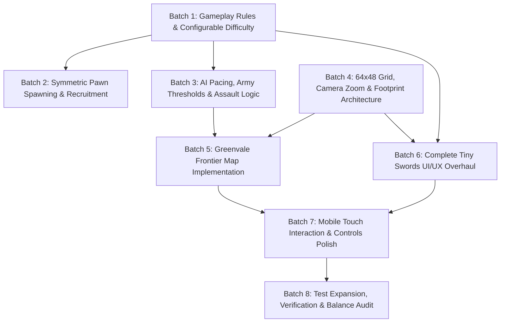

# Pocket Crusader — Master Implementation Plan & Execution Roadmap

**Status:** Approved for Direct Execution  
**Author:** Antigravity Systems Team (Lead Gameplay & Systems Engineer)  
**Execution Model:** Batch-driven, test-verified, incremental delivery  

---

## 1. Execution Dependency Graph

---

## 2. Implementation Batches

### Batch 1: Gameplay Rules, Data-Driven Stats & Difficulty Profiles
- **Objective:** Establish the data-driven balance configuration for starting resources, building costs, unit combat stats, and three difficulty tiers (Easy, Normal, Hard).
- **Files Modified / Created:**
  - Create: `src/game/config/BalanceConfig.ts` (Authoritative stats for economy, units, buildings, difficulty).
  - Modify: `src/store/slices/resourceSlice.ts` (Set starting wood: 100, gold: 60).
  - Modify: `src/store/slices/gameStateSlice.ts` (Add difficulty state: 'easy' | 'normal' | 'hard').
  - Modify: `src/game/entities/Warrior.ts` (Max HP: 120, Damage: 25, Interval: 1.2s).
  - Modify: `src/game/entities/King.ts` (Max HP: 600, Damage: 35).
- **Acceptance Criteria:**
  - TypeScript compiles with 0 errors.
  - Unit tests reflect new starting resource values and combat math.

### Batch 2: Symmetric Pawn Spawning & Robust Recruitment Pipeline
- **Objective:** Fix the asymmetric stronghold worker spawning bug, increase spawn interval to 20 seconds, enforce population limits for both factions, and guarantee safe worker drafting without interrupting active builders.
- **Files Modified:**
  - Modify: `src/game/managers/EntityManager.ts` (Independent spawn timers for Blue and Red factions; 20s interval; builder drafting protection; safe refund on cancel).
  - Modify: `src/game/entities/Stronghold.ts` (Visual spawn bar updates for both factions).
  - Modify: `src/game/entities/Barracks.ts` (Strict queue management; refund on cancel; spawn warrior at clear entrance tile).
- **Acceptance Criteria:**
  - Stronghold does not spawn workers when faction is at max population.
  - Active builders are never hijacked for warrior training.
  - AI Red faction properly spawns workers up to its population cap.

### Batch 3: Skirmish AI Pacing, Army Waves & State Machine
- **Objective:** Transform the Skirmish AI from a premature 1-warrior rusher into a strategic RTS opponent adhering to difficulty profiles.
- **Files Modified:**
  - Modify: `src/game/managers/AIManager.ts` (Integrate `AIDifficultyConfig`; implement Opening, Building, Training, Defense, and Assault phases; enforce minimum attack army size of 4 Warriors on Easy; enforce first attack delay of 3.5 minutes on Easy).
- **Acceptance Criteria:**
  - Easy AI does not attack before 3 minutes and requires at least 4 Warriors.
  - AI defends its base if attacked within defensive leash radius.
  - AI adapts dynamically to map base coordinates.

### Batch 4: 64×48 Grid, Camera Zoom & Footprint Architecture
- **Objective:** Expand the grid to 64 cols × 48 rows (4096×3072 px), update EasyStar iteration limits, implement bounds clamping, and configure mobile camera zoom levels.
- **Files Modified:**
  - Modify: `src/game/managers/GridManager.ts` (`GRID_COLS = 64`, `GRID_ROWS = 48`, `easystar.setIterationsPerCalculation(2000)`).
  - Modify: `src/game/scenes/GameScene.ts` (World dimensions 4096×3072; camera bounds and zoom limits `ZOOM_MIN = 0.45`, `ZOOM_MAX = 1.5`, default 0.75).
- **Acceptance Criteria:**
  - Pathfinding succeeds over 40+ tiles without dropping paths.
  - Camera clamping prevents viewing outside world bounds.

### Batch 5: Greenvale Frontier Battlefield Implementation
- **Objective:** Create the large, visually rich, strategically balanced skirmish battlefield with bilateral symmetry, forest clusters, gold quarries, central valley crossings, and natural chokepoints.
- **Files Modified:**
  - Create: `src/game/map/GreenvaleMap.ts` (Deterministic map definition and layout generator).
  - Modify: `src/game/scenes/GameScene.ts` (Spawn Greenvale Frontier terrain, resource nodes, bases at cols 10 and 50).
  - Modify: `src/game/managers/AIManager.ts` (Update base anchors to col 50, row 24).
- **Acceptance Criteria:**
  - Two balanced starting bases with safe starting trees and gold.
  - Symmetrical neutral resource outposts in North and South.
  - Defensible central crossings with natural terrain barriers.

### Batch 6: Complete UI/UX Overhaul Using Tiny Swords UI Elements
- **Objective:** Replace generic CSS glassmorphism, emojis, and gradient cards with the authentic Tiny Swords pixel-art UI (WoodTable, Papers, Buttons, Bars, Avatars, Icons).
- **Files Modified:**
  - Modify: `src/styles/App.module.css` (Pixel-art panel skinning, 9-slice / border-box styling, typography, responsive mobile layout).
  - Modify: `src/App.tsx` (Redesign Landing/Main Menu with difficulty selector and map indicator; redesign Top HUD bar; redesign Build Menu scroll; redesign Contextual Selection panel; redesign Victory/Defeat modal).
  - Modify: `src/game/scenes/Preloader.ts` (Ensure all UI icons and textures are loaded).
- **Acceptance Criteria:**
  - 100% authentic pixel art appearance.
  - Zero generic emojis in HUD or modals.
  - Touch targets >= 48px.

### Batch 7: Mobile Touch Interaction & Controls Polish
- **Objective:** Ensure seamless touch interaction on mobile viewports: responsive gesture zooming, smooth panning, clear selection indicators, and placement previews.
- **Files Modified:**
  - Modify: `src/game/managers/InteractionManager.ts` (Touch gesture tolerances, placement ghost alignment, selection hitboxes).
  - Modify: `src/styles/App.module.css` (Safe area insets and mobile viewport handling).
- **Acceptance Criteria:**
  - Panning does not issue accidental movement orders.
  - Building ghost can be dragged and placed accurately on mobile.

### Batch 8: Automated Test Expansion & Verification
- **Objective:** Expand the test suite to validate all redesigned balance rules, difficulty parameters, 64×48 coordinate math, population capping, and AI wave conditions.
- **Files Modified:**
  - Modify: `tests/gameplay_rules.test.ts` (Add comprehensive tests for balance config, difficulty curves, 64×48 grid math, and recruitment safety).
- **Acceptance Criteria:**
  - All tests pass (`npm test`).
  - TypeScript compilation clean (`npx tsc --noEmit`).
  - Game is verified playable and stable.

---

## 3. Risks & Mitigations

| Risk | Impact | Mitigation Strategy |
|---|---|---|
| **Pathfinding Lag on 64×48 Grid** | High | Configured EasyStar `setIterationsPerCalculation(2000)` and enabled diagonal routing with cardinal adjacency checks. |
| **Mobile Screen UI Clutter** | Medium | Collapsible contextual panels, compact top bar (54px), and touch event propagation prevention. |
| **Pawn Spawning Snowball** | High | Enforced strict population caps (+5 per house, max 30) with 20s base interval and capped resource consumption. |
| **AI Unit Target Locking** | Medium | Leash distance checks and immediate retargeting scan when primary target dies or exits range. |
